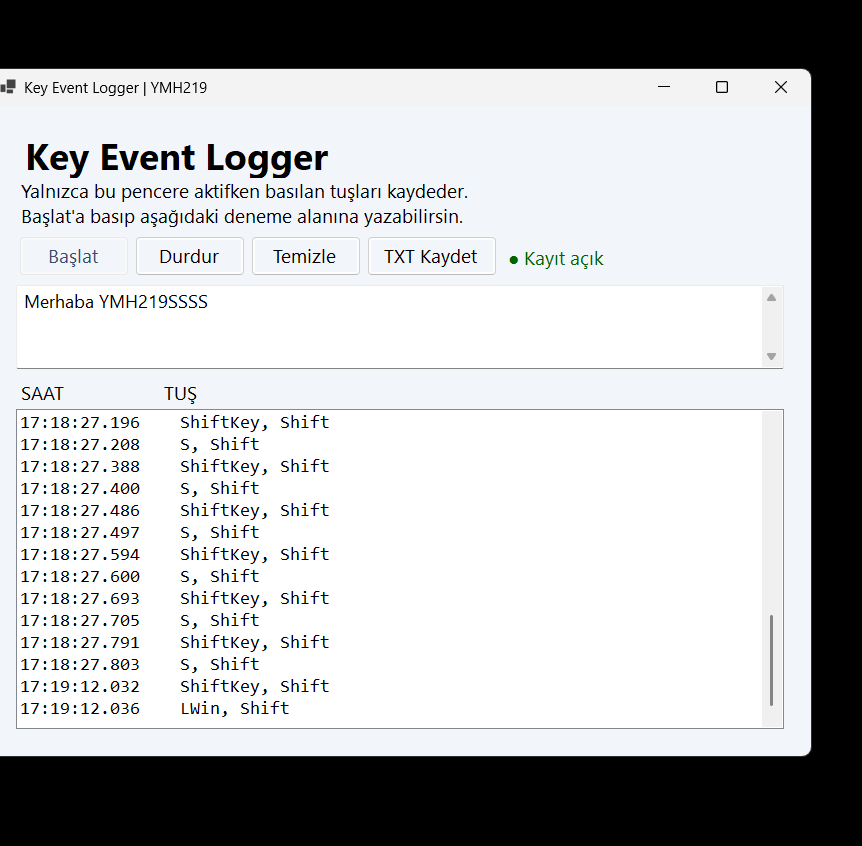
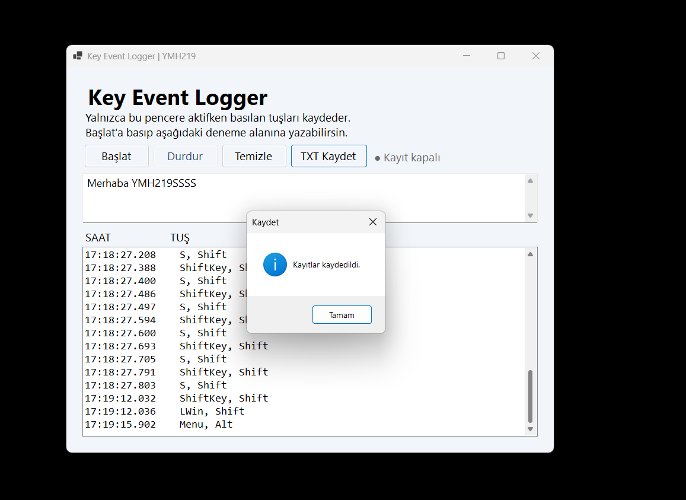

# YMH219 Key Event Logger

Windows Forms üzerinde klavye olaylarını ve olay zamanlarını gösteren C# uygulaması.

## Öğrenci

Özgür Ulusoy — 250541083

## Teknolojiler

C#, .NET 10, Windows Forms. Harici NuGet paketi kullanılmaz.

## Çalıştırma

Windows ve .NET 10 SDK gereklidir. Çözüm dosyası Visual Studio ile açılabilir veya depo klasöründe aşağıdaki komut çalıştırılabilir:

```powershell
dotnet run --project KeyEventLogger
```

## Kullanım

Başlat düğmesine basıp deneme alanına yazın. Basılan tuşlar ve saatleri listelenir. Durdur düğmesi yeni kayıt eklenmesini durdurur. Yalnızca uygulamanın kendi penceresindeki klavye olayları işlenir.

Temizle düğmesi listeyi ve deneme alanını boşaltır. TXT Kaydet düğmesi kayıtları tarih, saat ve tuş bilgileriyle UTF-8 metin dosyasına yazar. Dosya seçimi sırasında kayıt durdurulur; tekrar kayıt için Başlat'a basılır. Kaydetme hataları bir ileti kutusunda gösterilir.

## Ekran görüntüleri

### Tuş kaydı



### TXT dosyasına kaydetme



## Sınırlamalar

En son 5000 kayıt bellekte tutulur. Uygulama kapanınca kayıtlar silinir. Başka uygulamalardaki tuşlar yakalanmaz. Gizli çalışma, global klavye kancası veya ağ üzerinden gönderim bulunmaz.
